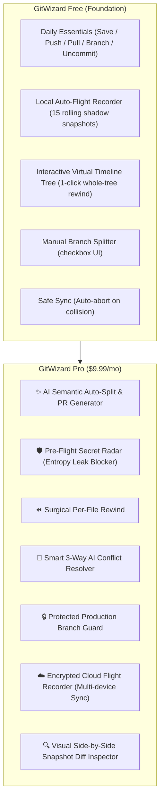
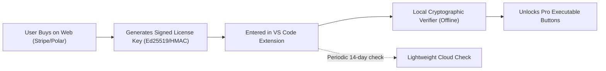

# 🧙‍♂️ GitWizard Pro — Product Specification & Implementation Blueprint

> **Target Version**: v1.1.0 – v2.0.0  
> **Price Point**: $9.99/month (or $99/year)  
> **Target Audience**: "Vibe Coders", AI-first developers, solo hackers, and small teams using Cursor, Claude Code, Antigravity, and Copilot.  
> **Living Document Status**: Active Master Reference for Pro Sprints

---

## 1. Executive Summary & The GitWizard DNA

### The Core Philosophy: "Zero Git Knowledge"
Traditional Git tools (GitKraken, SourceTree, Tower, VS Code Source Control) are **inspection tools** built for Git experts. They require the user to understand Git primitives: DAG trees, staging indexes, rebases, detached HEAD states, worktrees, and conflict markers.

**GitWizard operates on the exact opposite principle:**
1. **The Vibe Coder doesn't know (and doesn't want to know) Git internals.**
2. **Never just change the copy — turn complex multi-step Git workflows into 1-Click Executable Buttons.**
3. **Every button must have a Plain-English Preview Card and an Automated Rollback Airbag.**
4. **Zero Data Loss Guarantee**: No matter what happens (power loss, terminal kill, syntax error, merge clash), the workspace can always be rewound to the exact millisecond before the button was pressed.

---

## 2. Vibe Coder User Journeys (Before vs. After GitWizard Pro)

### Journey 1: The "Runaway AI Agent" (15 Files Touched)
* **The Disaster Today**: The developer asks an AI agent to "add Stripe billing and redesign user settings." The AI edits 15 files across backend routes, database schema, CSS, and UI components. The developer now has a massive dirty working tree. They don't know how to split this into clean PRs without breaking code or spending 45 minutes on `git add -p`.
* **The GitWizard Pro Experience**:
  1. The Webview detects 15 modified files.
  2. A vibrant button appears: **`[✨ Auto-Split with AI]`**.
  3. The user clicks it. GitWizard analyzes file dependencies and diffs, clustering them into 2 clean proposals:
     - Branch `feat/stripe-billing` (6 backend & schema files)
     - Branch `ui/settings-redesign` (9 UI & style files)
  4. The user clicks **`[Approve & Create PRs]`**.
  5. GitWizard safely snapshots, branches, commits with semantic conventional commit messages, and switches back cleanly. Total time: **10 seconds**.

---

### Journey 2: The "Silent Destruction" (AI Deleted Vital Code)
* **The Disaster Today**: The AI agent refactors a component and silently deletes 40 lines of authentication validation. The developer notices 30 minutes later, but they've already written other new code in 5 other files. Running `git reset --hard` will erase their new work.
* **The GitWizard Pro Experience**:
  1. The user opens the **Virtual Timeline Tree**.
  2. They right-click the damaged file (`auth.ts`): **`[⏪ Rewind This File to 30 mins ago]`**.
  3. A preview shows the exact deleted lines highlighted in green.
  4. User clicks **`[Restore File]`**.
  5. Only `auth.ts` is restored from the shadow snapshot. The rest of the working tree remains 100% untouched.

---

### Journey 3: The "Accidental Secret Leak"
* **The Disaster Today**: The AI agent creates a mock script and hardcodes `OPENAI_API_KEY = "sk-proj-..."`. The developer clicks "Commit & Push". Within 90 seconds, automated scraping bots steal the key and burn $2,000 in API credits.
* **The GitWizard Pro Experience**:
  1. When clicking **`[Save My Work]`** or **`[Send & Update]`**, GitWizard's **Pre-Flight Secret Radar** scans the diff using high-entropy token detectors.
  2. It intercepts the commit with an alert card:
     > 🛑 **Secret Detected**: Found OpenAI API Key in `services/ai.ts:L14`.
  3. GitWizard presents a 1-click fix button: **`[🔒 Move to .env & Add to .gitignore]`**.
  4. The secret is extracted into `.env`, the variable reference is injected, `.env` is verified in `.gitignore`, and the commit proceeds safely.

---

### Journey 4: The "Remote Collision" (Merge Conflict Panic)
* **The Disaster Today**: The developer pulls latest changes from their teammate or another laptop. Git spews `CONFLICT (content): Merge conflict in routes.ts`, leaving raw `<<<<<<< HEAD` markers across the file. The developer has no idea how to resolve it and accidentally commits conflict markers.
* **The GitWizard Pro Experience**:
  1. GitWizard's SafeSync immediately catches the collision and prevents corruption.
  2. A calm card appears: **`[✨ Auto-Resolve with AI]`**.
  3. GitWizard sends both sides of the conflict to an LLM with semantic context.
  4. The AI returns a unified, working solution.
  5. The user reviews a visual side-by-side diff and clicks **`[Accept AI Resolution]`**.

---

## 3. Detailed Pro Feature Specifications (The Executable Button System)

---

### 3.1. Feature 1: ✨ AI Semantic Auto-Split & PR Generator
* **User Intent**: *"I have 20 dirty files from an AI coding marathon. Organize them into clean branches and pull requests automatically."*
* **The Executable Button**: `[✨ Auto-Split with AI]`
* **Workflow Engine**:
  1. `GitClient.getStatus()` retrieves all staged, modified, and untracked files.
  2. Engine inspects diff hunks and file import graphs.
  3. Sends diff summary to LLM prompt:
     `"Group these 18 modified files into 2-3 logical, self-contained feature branches. Output branch names, conventional commit messages, and a 2-paragraph PR summary for each."`
  4. Renders an interactive **Split Preview Card** in the Webview with checkboxes.
  5. On clicking **`[Execute Split]`**, `TransactionRunner` executes the branch creation, isolated file staging, commits, and switches cleanly back to `main`.
* **Rollback Guarantee**: Pre-split snapshot (`refs/gitwizard/snapshots/pre-ai-split-*`) created before execution.

---

### 3.2. Feature 2: 🛡️ Pre-Flight Secret Radar (Entropy Leak Blocker)
* **User Intent**: *"Never let me or my AI agent accidentally push API keys, database passwords, or private tokens to GitHub."*
* **The Executable Button**: Integrated into all commit and push buttons with status badge: `[🛡️ Radar: Safe]` or `[🚨 Radar: 1 Secret Blocked]`.
* **Workflow Engine**:
  1. Runs before `safeCommit()` or `safePush()`.
  2. Analyzes git diff using regex patterns + Shannon entropy scoring for:
     - OpenAI (`sk-[a-zA-Z0-9]{48}`), Anthropic, AWS (`AKIA...`), GitHub PATs (`ghp_...`), Stripe (`sk_live_...`, `rk_live_...`), Google Gemini (`AIza...`), Slack tokens, database connection URIs.
  3. If found, aborts execution instantly and displays an alert card.
  4. Executable action: **`[Extract to .env & Ignore]`** automatically rewrites the code to `process.env.VARIABLE_NAME`, appends the secret to `.env`, and ensures `.env` is listed in `.gitignore`.

---

### 3.3. Feature 3: ⏪ Surgical Per-File Rewind
* **User Intent**: *"I only want to undo changes in this ONE file back to how it was 20 minutes ago. Don't touch any of my other files."*
* **The Executable Button**: In Webview Virtual Timeline nodes and VS Code context menu: `[⏪ Rewind This File to Checkpoint]`
* **Workflow Engine**:
  1. User selects target file and target snapshot ID (`snapId`).
  2. Safety snapshot created: `pre-file-restore-<filename>`.
  3. Git plumbing execution:
     `git checkout refs/gitwizard/snapshots/<snapId> -- <filePath>`
  4. Main index and all other working files remain untouched.
  5. Instant notification: *"Restored `src/auth.ts` to state at 3:15 PM without affecting other files."*

---

### 3.4. Feature 4: 🤖 Smart 3-Way AI Conflict Resolver
* **User Intent**: *"My pull failed because someone else edited the same file. Don't make me read Git conflict syntax — just fix it."*
* **The Executable Button**: `[✨ Auto-Resolve with AI]`
* **Workflow Engine**:
  1. Triggered when `SafeSyncWizard` or `DailyEssentialsWizard.safePull` detects a conflict.
  2. Extracts the 3 sides of the conflict:
     - Base common ancestor (`git merge-base`)
     - Local changes (`OURS`)
     - Incoming remote changes (`THEIRS`)
  3. Prompts LLM:
     `"Resolve the merge conflict in this file. Maintain the intent of both changes. Return ONLY valid, compilable code without conflict markers."`
  4. Shows visual side-by-side comparison:
     - Left: Conflict / Incoming
     - Right: AI Proposed Resolution
  5. Executable action: **`[Accept Resolution & Finish Sync]`**.

---

### 3.5. Feature 5: 🔒 Production Branch Guard (The Main Airbag)
* **User Intent**: *"Prevent me or an autonomous AI script from accidentally running a hard reset or direct commit on `main`."*
* **The Executable Button**: `[🛡️ Create Feature Branch Instead]`
* **Workflow Engine**:
  1. Configurable list of protected branches (`main`, `master`, `production`, `release/*`).
  2. Intercepts any commit or reset attempted while directly on a protected branch.
  3. Modal popup:
     *"⚠️ Direct commits to 'main' are protected in GitWizard Pro. Would you like to create a feature branch for these changes?"*
  4. 1-click button creates `feat/<suggested-name>`, moves changes there, and leaves `main` pristine.

---

### 3.6. Feature 6: ☁️ Encrypted Cloud Flight Recorder
* **User Intent**: *"I switch between my desktop and laptop. I want my snapshot timeline everywhere, and I want an off-site backup if my disk dies."*
* **The Executable Button**: `[☁️ Sync Snapshots to Cloud]`
* **Workflow Engine**:
  1. Client-side AES-256-GCM encryption with user's private key.
  2. Compact packfile bundles generated via `git bundle create`.
  3. Uploaded to secure snapshot storage (Cloudflare R2 / AWS S3).
  4. Timeline displays snapshots taken across all linked devices with device icons (`💻 Laptop`, `🖥️ Desktop`).

---

## 4. Monetization & Licensing Architecture

### Pricing
* **Monthly**: **$9.99 / month**
* **Annual**: **$99 / year** (saves 17%)
* **Free Trial**: **14-day full Pro access** with zero credit card required.

### 4.1. Lightweight, Offline-First Cryptographic Licensing
To avoid annoying developers with constant network requests or failing when coding offline on planes:

* **License Key Format**: `GWPRO-<version>-<expiryTimestamp>-<emailBase64>-<signature>`
* **Offline Verification**: Verified locally in TypeScript using public key cryptographic verification (`node:crypto`). Works 100% offline.
* **Grace Period**: 7-day grace period if renewal fails.
* **Safety First**: If a license expires, **GitWizard NEVER locks users out of their code**. All Free tier safety features remain functional forever.

---

## 5. Multi-Sprint Implementation Roadmap

### 🗓️ Sprint 7: Pro Foundation & AI Semantic Commit/PR Generator
* **Objective**: Build licensing gatekeeper, Pro UI badge system, and the AI Commit & Auto-PR Generator.
* **Tasks**:
  1. `src/pro/license.ts`: Cryptographic license key validator and 14-day trial tracker.
  2. `src/pro/ai-service.ts`: Provider-agnostic LLM interface supporting Gemini API, OpenAI, and BYOK (Bring Your Own Key) options.
  3. `src/wizards/ai-commit.ts`: Semantic conventional commit message generator from git diff.
  4. Webview UI update: Pro indicator badge, "Generate with AI" button in Daily Essentials deck, and License Key modal.
  5. Test suite in `test/pro/ai-commit.test.ts` & `test/pro/license.test.ts`.

---

### 🗓️ Sprint 8: Pre-Flight Secret Radar & Production Branch Guard
* **Objective**: Protect vibe coders from catastrophic API key leaks and accidental commits to `main`.
* **Tasks**:
  1. `src/pro/secret-scanner.ts`: High-performance diff scanner with regex catalog + Shannon entropy detection.
  2. `src/pro/secret-remediation.ts`: 1-click `.env` extraction and `.gitignore` patching.
  3. `src/pro/branch-guard.ts`: Protected branch interceptor and 1-click branch redirector.
  4. Integrate Secret Radar into `DailyEssentialsWizard.safeCommit()` and `safePush()`.
  5. Test suite in `test/pro/secret-scanner.test.ts` & `test/pro/branch-guard.test.ts`.

---

### 🗓️ Sprint 9: Surgical Per-File Rewind & AI Auto-Split
* **Objective**: Enable per-file surgical time travel and multi-branch AI clustering.
* **Tasks**:
  1. `src/pro/file-rewind.ts`: Single-file checkout from snapshot refs preserving main working index.
  2. `src/pro/ai-splitter.ts`: LLM diff clustering into multiple semantic branches.
  3. Webview UI: Right-click file rewind in Virtual Timeline Tree, and "Auto-Split with AI" button in Branch Splitter view.
  4. Test suite in `test/pro/file-rewind.test.ts` & `test/pro/ai-splitter.test.ts`.

---

### 🗓️ Sprint 10: Smart AI Conflict Resolver & Cloud Sync Bridge
* **Objective**: Eliminate merge conflict dread and deliver cross-device encrypted cloud backup.
* **Tasks**:
  1. `src/pro/conflict-resolver.ts`: 3-way merge extraction, LLM resolution generation, and compilability validation.
  2. `src/pro/cloud-sync.ts`: AES-256 client-side encryption and bundle sync API client.
  3. Webview UI: 3-way visual resolution card with 1-click apply.
  4. Packaging and release of **GitWizard Pro v2.0.0**.

---

## 6. Definition of Done & Success Metrics

| Metric | Target |
|:---|:---|
| **Zero Git Knowledge Usability** | A developer who does not know Git syntax can execute all workflows using buttons only. |
| **Airbag Rollback Reliability** | 100% of Pro operations restore to pre-transaction snapshot on failure. |
| **Secret Scan Latency** | Full working tree diff scanned in **< 150ms** before commit. |
| **Offline Reliability** | Pro license remains valid offline without network connection. |
| **Test Coverage** | Every Pro feature backed by isolated automated unit tests in `test/pro/`. |
